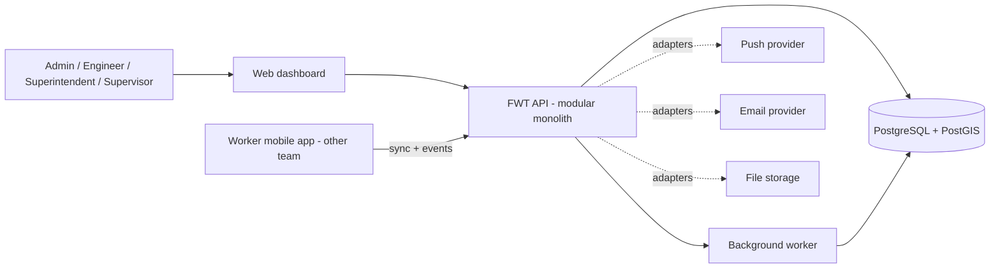

# 01 - Product Overview

## Purpose
**Product name: Field Worker Tracker (FWT).** (An older client document calls it "SGS Field Tracker".)

FWT manages a field workforce for a facilities/landscaping company: who works where, when, for how long, what it costs, and proof that it happened. It covers the chain from **employee master data and reporting hierarchy** through **recurring job schedules**, **mobile location events**, **attendance**, **approvals**, **payroll and staff cost**, and **reports**.

## Scope
**In scope (this project)**
- Backend API (FastAPI) and PostgreSQL/PostGIS database
- Web dashboard for Admin, Engineer, Superintendent, Supervisor
- Bulk Excel import (template provided to the client)
- Yearly **planner** with a weekly **roster** view, leave, temporary reassignments with engineer approval, **time rules** (planned times, seasons, groups), event ingestion, attendance engine and review
- **Transport**: a Drivers section with daily runs (driver, stops, workers)
- Worker salary structures, overtime, provisions, automatic month-end **draft payroll** with Admin approval, immutable snapshots, job budget and costing
- Reports and Excel exports, **live map and management dashboard**, alerts (tracking interrupted, pending visits, document expiry), audit log
- The **mobile API contract** (sync + event upload) and its documentation

**Out of scope**
- The mobile application itself (separate team)
- Checklists (the requirements spec excludes them; the client's older Inputs/Outputs document mentions them - see `reference/client-io-document-summary.md`), biometric attendance (checklists and manual shift confirmation are confirmed out of scope, DEC-40), wage-file bank export (WPS/Mudad) - may be added later; see open decisions
- A configurable role/permission engine (roles are fixed)

## System context

## Actors
| Actor | Uses | Core purpose |
|---|---|---|
| Admin | Web | Imports, master data, settings, salary, accounts, devices |
| Engineer | Web (+mobile) | Operational management in scope, attendance approval |
| Superintendent | Web (+mobile) | Oversight and reporting in scope |
| Supervisor | Web (+mobile) | Comments, temporary reassignment, reports |
| Worker | Mobile only | Sees own schedule/profile/pay info; produces events |

## Core principles
1. The backend is authoritative for schedules, attendance, payroll, permissions.
2. The phone **only collects** observations and stores what it needs offline. The server verifies locations against polygons itself.
3. Raw events are preserved forever (per retention policy). Corrections and approvals are separate records.
4. Finalized attendance and payroll keep the values used, even if configuration changes later.
5. Referenced records are deactivated, never deleted.
6. Provider-specific code (maps, push, email, storage) sits behind adapters so it can be swapped.
7. Country-specific rules live in a Country Rule Pack, chosen per record. Each country runs as its own stack (ADR-009).

## Glossary
| Term | Meaning |
|---|---|
| Tally ID | Client business ID of an employee (text). Reporting links use it. |
| Parent Job / Worksite | A physical job number (e.g. `32A14119`) with one boundary polygon |
| Job Item | A sub-item (A, B, C...) of a Worksite with its own staff type, frequency, headcount and hours |
| Occurrence | One required execution of a Job Item (or a window in which it must happen) |
| Scheduled Work | One employee + one date + one occurrence + assigned hours + sequence |
| Standard hours | The worker's normal daily hours (8, 10 or 12) from the salary structure; overtime is counted beyond them |
| Roster | Weekly view: workers down, days across, each day showing sites with hours or a status (Free, Weekly-OFF, skipped) |
| Standing assignment | A worker assigned to a job item for a date range; generates daily work |
| Time rule | Planned accommodation start, first-site start, break, last-site end and accommodation end, set for the company, a team, the drivers or one person, optionally for a season |
| Run | One transport trip: a driver, ordered stops and the workers at each stop |
| Budget-only staff type | A staff type (HSE Engineer, Project Manager...) that only exists for the job budget: never scheduled or tracked |
| Staff Grade Description (SGD) | Role label used to **match workers to job items** (e.g. Gardener Expert) |
| Grade Code | Salary label used to **pick the salary row** (e.g. G2B26). Not used for matching |
| Boundary | Polygon geofence of a worksite or accommodation |
| Geofence circle | Outer circle derived from the boundary that wakes location polling on the phone |
| Site visit | A confirmed ENTRY to EXIT interval inside a worksite polygon |
| Tracking gap | Period between LOCATION_DISABLED and the next LOCATION_ENABLED |
| Work date | Local calendar date of a shift in the site's country time zone |
| FOT | Fixed overtime built into a grade's monthly pay |
| OT1 / OT2 | Overtime at x1.25 / x1.5 of the basic hourly rate |
| CTC | Cost to company per month before provisions (8-hour total + FOT) |
| Provision | Employer cost accrued per employee (gratuity, leave salary, visa, air ticket, uniform, accommodation, medical, transportation) |
| HR OH | Overhead percentage added to total staff cost (5%, configurable) |
| Rule Pack | Country-specific rules (weekend, holidays, OT days, restrictions) |

## Success criteria
- Import the client's data via the template with a clear preview and error report.
- A week of schedules for ~500 workers can be built and adjusted in the week view.
- The mobile team can build against the contract without our involvement beyond the spec.
- Attendance for a day is reproducible from raw events and explains itself on the timeline.
- Finalized payroll never changes after the fact.
