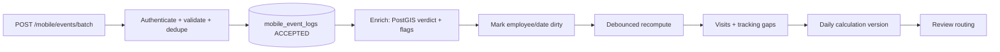

# 05 - Event Ingestion and Attendance Engine

Pure logic in `backend/src/fw/rules/attendance/`; orchestration in `modules/events` and `modules/attendance`.
The phone is a **data collector**. The server verifies everything against its own polygons.

## 1. Mobile tracking flow (what the app does; for context)
1. Alarm rings at the company-set time. When the worker stops it, location tracking turns on (per the policy accepted at first install).
2. For that day's worksites (and the accommodation) the app creates **geofence circles** from the boundary data.
3. On entering a circle, the app starts **approach polling** (interval from settings) until a location falls **inside the polygon**.
4. Inside -> logs `ENTRY`. Then **confirmation polling** continues; each confirmation is a `PING`.
5. When the circle shows the worker left, the app polls to confirm they are outside, then logs `EXIT`.
6. If location is switched off: `LOCATION_DISABLED` carrying the **last polled location and its capture time**. When switched on again: `LOCATION_ENABLED` carrying the **new location**.
The interval between those two events and the two locations are the evidence of any tracking gap.

## 2. Event contract (server side)
Fields: `event_id` (device UUID), `employee_id` (from the token, never the payload), `device_id`, `job_id`/`job_item_id` (nullable hints), `event_type`, `event_timestamp_utc`, `latitude`, `longitude`, `accuracy_meters`, `sequence_number` (optional), `received_at_utc` (server).
Proposed extensions **[DEC-13]**: `location_captured_at_utc`, `is_mock_location`, `accommodation_id` (hint).
Types: `ENTRY`, `EXIT`, `PING`, `LOCATION_DISABLED`, `LOCATION_ENABLED`. There is **no** generic `source` field. Explicit `CLOCK_IN`/`CLOCK_OUT` are not used unless the workflow is approved later.

## 3. Pipeline


### Stage 1 - ingestion (synchronous, fast)
- Device must be the worker's active registered device, else `403 DEVICE_NOT_ACTIVE` (whole batch).
- Per event validation; failures return `REJECTED` with a reason: `INVALID_SCHEMA`, `INVALID_COORDINATES`, `TIMESTAMP_IN_FUTURE` (> `event_future_tolerance_s` ahead of server time), `TIMESTAMP_TOO_OLD` (> `event_max_age_days`).
- Dedupe by `event_id` (primary key, `ON CONFLICT DO NOTHING`) -> `DUPLICATE` (not an error; retries are expected).
- Persist accepted events **before** responding. Response is per event: `ACCEPTED | DUPLICATE | REJECTED(reason)`, plus `latest_cursor` and `server_time_utc`.
- Clock check **[DEC-14]**: `skew = server_now - batch.device_clock_utc`. If `abs(skew) > clock_skew_tolerance_s` every event in the batch gets flag `CLOCK_SKEW` and the skew is stored. Event times are never rewritten.

### Stage 2 - enrichment (background)
For each event compute and store (separate columns from the device's claim):
- `server_site_id` / `server_accommodation_id` = polygon containing the point (`ST_Covers`), if any
- `server_verdict`: INSIDE, BORDERLINE (outside but within `accuracy_meters` of the polygon), OUTSIDE, NO_POLYGON
- `distance_to_polygon_m`
- flags: `LOW_ACCURACY` (`accuracy_meters > max_location_accuracy_m`), `MOCK_LOCATION`, `UNKNOWN_SITE`, `ENTRY_OUTSIDE_POLYGON` (ENTRY not INSIDE/BORDERLINE), `EXIT_INSIDE_POLYGON` (EXIT verdict INSIDE)

LOW_ACCURACY events are stored and shown but **never used to confirm an ENTRY/EXIT**.

### Stage 3 - recompute
Mark `(employee_id, work_date)` dirty. A debounced job (default 2 minutes after the last new event, and always at end of day) rebuilds the day. A calculation **input hash** (events + scheduled work + resolved settings + salary line) is compared with the current version; identical input creates no new version.

## 4. Visits
Process the day's verified events in time order (tie-break by `sequence_number`, then `received_at`). One open visit per worksite.
- `ENTRY` with verdict INSIDE/BORDERLINE and no open visit -> open a visit. Duplicate ENTRY while open -> ignore, flag `DUPLICATE_ENTRY`.
- `PING` INSIDE while open -> update `last_inside_at`. `PING` OUTSIDE while open -> flag `LEFT_WITHOUT_EXIT`, close the visit at `last_inside_at` as INFERRED **[DEC-05]**.
- `EXIT` with verdict OUTSIDE/BORDERLINE and an open visit -> close at the event time (OBSERVED). `EXIT` with verdict INSIDE -> do not close, flag `EXIT_INSIDE_POLYGON`. `EXIT` with no open visit -> flag `ORPHAN_EXIT`.
- End of day with an open visit and `inferred_exit_allowed` -> close at `last_inside_at`, INFERRED, flag `MISSING_EXIT`.
- A visit shorter than `min_visit_minutes` does not count as completed **[DEC-24]**.
- Visits to a worksite with no Scheduled Work that day are kept and flagged `UNASSIGNED_SITE_VISIT`.
The same logic runs for accommodation polygons to produce accommodation departure (EXIT) and return (ENTRY).

## 5. Tracking gaps
`LOCATION_DISABLED` opens a gap (location = last polled location, `location_captured_at` = when it was read). The next `LOCATION_ENABLED` closes it (location = resume location). Stored in `tracking_gaps` with duration, both locations, distance between them, and whether each end is inside a worksite.
- Accepting a `LOCATION_DISABLED` event raises a `TRACKING_INTERRUPTED` alert to the worker's in-scope Supervisors/Engineers (in-app, push/email via adapters); the matching `LOCATION_ENABLED` clears it. Mobile apps therefore upload these two events immediately when online.
- Open gap at end of day: closed at the day's last event, `is_inferred = true`.
- **Unaccounted time** = total tracking-off minutes inside the shift span minus `break_minutes_used` (never below 0), so location switched off during the break is not penalised. If unaccounted time exceeds `gap_flag_minutes` the day gets flag `TRACKING_GAP` and is routed to review. **No automatic deduction** **[DEC-04]**. The report shows the unaccounted hours.
- If a visit is open across a gap and the resume location is inside the same polygon, the visit continues (gap still flagged). If outside, the visit is closed at the disabled time as INFERRED.

## 6. Daily calculation
Inputs: ACTIVE Scheduled Work for the date, settings and time rules **as in force on the work date** (effective-dated, see 03 BR-ST-04/05; recalculating an old date uses that date's values), employee `is_driver`, visits, gaps, approved leave, public-holiday and weekly-off flags.

**Planned values** come from the resolved **time rule** for the worker, date and job type (see 03 BR-AT-06/13 and `design/D3-time-rules-and-attendance-report.md`): accommodation start, first-site start, break, last-site end, accommodation end, and the standard-hours change. Planned total time = accommodation end - accommodation start; planned worked time = last-site end - first-site start - break (e.g. 05:00 / 06:00 / 0:30 / 15:30 / 17:00 gives 12:00 total and 09:00 worked).
`required_minutes = sum(assigned_hours) * 60` over ACTIVE assignments (the day's assigned work); `standard_minutes` = the worker's standard hours (salary structure) adjusted by time rules.
`required_minutes = sum(assigned_hours) * 60` over ACTIVE FIELD_WORK Scheduled Work.

**Effective break** **[DEC-03, DEC-41]**: the job-item `break_override_minutes` of the first site visited that day, else the resolved time rule (employee, team, drivers, company/season). A rule with a blocked window counts the window as break for the affected (outdoor) jobs. Save `break_minutes_used` and `break_source`. The attendance table shows the break applied by the rule, since actual break timing is not measured.

**Regular worker**
```
first_site_entry = min(visit.entry_at)   over confirmed visits
last_site_exit   = max(visit.exit_at)
elapsed_site_min = last_site_exit - first_site_entry
worked_min       = max(0, elapsed_site_min - break_minutes_used)
```
Inter-site travel stays inside the interval. The accommodation commute is recorded for movement reports but excluded from `worked_min`.

**Driver** **[DEC-27]**
```
worked_min = (accommodation_return - accommodation_departure) - break_minutes_used   # setting driver_deduct_break
```
If accommodation events are missing, flag `NO_ACCOMMODATION_EVENTS` and fall back to the regular formula (labelled).

**Variation and grace**
```
variation_min = worked_min - required_min          # signed
shortfall_min = max(0, -variation_min)
grace_applied = 0 < shortfall_min <= grace_period_minutes
satisfied     = shortfall_min == 0 or grace_applied
```
Actual worked time is never changed to match the plan.

**Counts**: `assigned_count` = ACTIVE Scheduled Work rows; `completed_count` = rows whose worksite has a confirmed visit (>= `min_visit_minutes`).

**Business status** **[DEC-17]**: PRESENT if `completed_count == assigned_count > 0`; PARTIAL if `0 < completed_count < assigned_count`; ABSENT if `completed_count == 0`, there were assignments and no approved leave. A shortfall beyond grace is flag `SHORTFALL_BEYOND_GRACE`, not a status.
**Attendance by role**: workers, supervisors, superintendents and engineers are measured by **site visits** (first site entry to last site exit). Only **drivers** use accommodation departure to return. A worker without company accommodation has no accommodation times (columns show n/a; total time = first site to last site).

**Overtime** **[DEC-01]** (OT is calculated for every worker; fixed OT is a fixed monthly amount and is not touched):
```
ot2_day = date is a public holiday  or  weekday in ot2_weekdays (default Sunday)
if ot2_day:                          ot2 = worked_min ; ot1 = 0
elif date is the worker's weekly off day or the worker has no assignment that day:
                                     ot1 = worked_min                 # normal rate rule: all hours are OT1
else:                                ot1 = max(0, worked_min - standard_minutes)   # beyond standard hours (8/10/12 or reduced)
```
A day that is both an OT2 day and a weekly off day is OT2. Days with no assignment but worked time also carry flag `UNSCHEDULED_WORK`. Overtime is reviewed by the Engineer before it is paid (see 7).

## 6b. Movement segments: productive, transit, idle   [DEC-28]
Computed once per calculation and stored (used by the utilization and transportation reports).
```
shift_span_minutes = accommodation_return - accommodation_departure      # fallback: last_site_exit - first_site_entry (labelled)
productive_minutes = max(0, sum(counted visit minutes at assigned worksites) - break_minutes_used)
transit_minutes    = sum(next.entry_at - prev.exit_at) over consecutive polygon visits (accommodation <-> site, site <-> site)
                     where the interval <= max_transit_minutes
offsite_minutes    = sum of longer intervals outside any polygon (unaccounted)
idle_minutes       = max(0, shift_span - productive - transit - break_minutes_used)   # includes offsite and time inside the accommodation or unassigned sites
```
For drivers (`is_driver = true`), transit counts as productive. All transit/offsite/idle values are INFERRED (polygon entries/exits plus sparse pings) and tagged so in reports.

## 6c. Pending visits   [DEC-32]
At day close (`planned_last_site_end + day_close_delay_minutes`, site-local) a job `detect_pending_visits` creates a `pending_visits` row for each ACTIVE Scheduled Work without a counted visit and no approved leave, status OPEN. Occurrences whose window ended without their required man-hours are also flagged. Follow-up: Supervisor explains (comment type PENDING_VISIT_EXPLANATION) -> EXPLAINED; Engineer reschedules (new Scheduled Work, source FOLLOW_UP) -> RESCHEDULED, or closes with a reason -> CLOSED. Reminders: `PENDING_VISIT` alerts every `pending_visit_reminder_hours` while OPEN.

## 7. Review routing
A day needs **review** only when it has a **variation beyond grace** (worked or total time), any **review flag**, or **overtime**. The Engineer (scope) approves those rows, singly or in bulk; Supervisors comment on rows with a difference. Rows with no variation, no flag and no overtime are **AUTO** and need no approval **[DEC-43]**. Review status: AUTO, PENDING_REVIEW, APPROVED, REJECTED (returned).
Flags that route to review: `SHORTFALL_BEYOND_GRACE`, `MISSING_EXIT`, `INFERRED_EXIT`, `TRACKING_GAP`, `UNASSIGNED_SITE_VISIT`, `UNSCHEDULED_WORK`, `CLOCK_SKEW`, `MOCK_LOCATION`, `BORDERLINE_LOCATION`, `NO_ACCOMMODATION_EVENTS`, `CROSSES_MIDNIGHT`.

| From | To | Who | Rule |
|---|---|---|---|
| AUTO | (none) | - | no action |
| PENDING_REVIEW | APPROVED | Engineer (scope), Admin | optional comment |
| PENDING_REVIEW | REJECTED | Engineer, Admin | reason required (returned for correction) |
| REJECTED | PENDING_REVIEW | Supervisor adds a comment, or a recalculation | automatic |
| APPROVED | PENDING_REVIEW | system | a new version changes worked minutes, OT minutes or business status |
Supervisor comments never change events or master data. Overtime counts for payroll only when its row is APPROVED (or AUTO with no OT).

### Review reasons (named)
Each flag that routes a day to review has a plain name shown as a chip on the attendance screen, so reviewers know what to look at:

| Reason (chip) | Flag | Meaning |
|---|---|---|
| Estimated exit | `MISSING_EXIT`, `INFERRED_EXIT`, `LEFT_WITHOUT_EXIT` | exit was not recorded; estimated from the last location reading |
| Tracking off | `TRACKING_GAP` | unaccounted tracking-off time beyond the break |
| Short hours | `SHORTFALL_BEYOND_GRACE` | worked less than required beyond grace |
| Other site | `UNASSIGNED_SITE_VISIT` | visited a site that was not assigned |
| Unscheduled work | `UNSCHEDULED_WORK` | worked with no assignment |
| Device clock | `CLOCK_SKEW` | device time differs from server time |
| Mock location | `MOCK_LOCATION` | phone reported a mocked location |
| Weak location | `BORDERLINE_LOCATION`, `LOW_ACCURACY` | location near the edge or low accuracy |
| No accommodation data | `NO_ACCOMMODATION_EVENTS` | driver day without accommodation events |
| Midnight crossing | `CROSSES_MIDNIGHT` | shift crossed local midnight |
Stored as `review_reasons` (the subset of flags that triggered review) on each calculation.

## 8. Versioning and recalculation
- `attendance_records`: one per (employee, work_date) **[DEC-16]** (days with Scheduled Work or any accepted event). Holds current pointers and review status.
- `attendance_calculations`: immutable versions with a full snapshot of inputs and results (see `07-data-model.md`).
- Settings are effective-dated: a change only affects dates on or after its start date, and recalculating any date uses the values in force on that date, never today's.
- Recalculate when: new events arrive for the date; scheduled work for the date changes; a setting/override affecting an **unfinalized** date changes; an Admin triggers recalculation; an approved correction is applied.
- Dates inside a FINALIZED payroll period are locked: recalculation may create a version flagged `POST_FINALIZATION` but payroll snapshots never change.

## 9. Timeline (derived view)
Items: events, visits, gaps, accommodation departure/return, inferred segments, each labelled **OBSERVED** or **INFERRED**. The default view collapses repeated PINGs inside a visit into "first ... last (n pings)". Straight lines between GPS points are visualization estimates, not proof of the route. Raw records stay available on demand.

## 10. Watchdogs
- **No-activity alert**: Scheduled Work exists today, no accepted event by the day's alarm time (DAY_PLAN: planned accommodation start minus `alarm_lead_minutes`) plus `no_activity_alert_after_minutes` -> alert to the supervisor. Clears on the first event.
- **Stale device**: `last_seen_at` older than `stale_device_hours` -> flag on the device list and employee screen.
- **Urgent sync lag**: a change affecting today unacknowledged for 30 minutes -> alert.
- **Live position**: each enriched event upserts `employee_last_position` and emits a `NOTIFY` so the live map updates (see 13 section 12).

## 11. Worked examples
**A - regular day.** Assigned 3 + 2 + 3 = 8 h. Standard hours 8 (480 min). First entry 06:20, last exit 15:20, break 30. Elapsed 540, worked 510, variation vs required +30. Not an OT2 day, so OT1 = 510 - 480 = **30 min**. Row goes to review because of overtime.
**B - grace.** Required 480, worked 475: shortfall 5 <= 10 -> `grace_applied=true`, satisfied; variation stays -5.
**C - missing exit.** ENTRY 06:30, last inside PING 14:55, no EXIT. Visit closed 14:55 INFERRED, flag `MISSING_EXIT` -> PENDING_REVIEW. Supervisor comments; Engineer approves or rejects.
**D - tracking gap.** DISABLED 10:05 (last location inside Site A, captured 10:03), ENABLED 11:40 (inside Site A). Gap 95 min; break used 30 -> **unaccounted 65 min** > 15 -> flag `TRACKING_GAP`; visit continues; PENDING_REVIEW; worked time unchanged.
**E - driver.** Departure 05:30, return 16:10, break 30 -> worked 610 min.
**F - Sunday or public holiday.** A worker works 8 h -> `ot2 = 480`, `ot1 = 0`.
**G - weekly off day or day with no assignment.** A worker works 8 h on their weekly off day (not Sunday/holiday) -> `ot1 = 480` (all hours OT1), flag `UNSCHEDULED_WORK` if no assignment.
**H - client's attendance table.** Planned 05:00 / 06:00 / 0:30 / 15:30 / 17:00 (total 12:00, worked 09:00); actual 05:20 / 06:20 / 0:30 / 15:20 / 16:50 (total 11:30, worked 08:30): variation in total time -00:30, in worked time -00:30 -> row needs supervisor comment and engineer approval.
