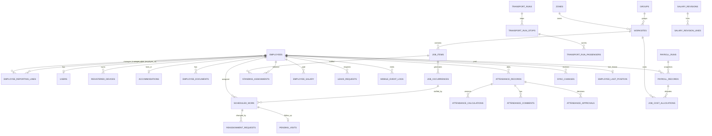

# 07 - Data Model

PostgreSQL 16 + PostGIS. SQLAlchemy 2.0 models, Alembic migrations (see `.agents/skills/db-migration`). This document is the schema contract: the agent generates models and migrations from it.

## Conventions
- Table names plural `snake_case`. Primary key `id uuid default gen_random_uuid()` unless stated. 
- `created_at`, `updated_at` `timestamptz not null default now()` on every table (omitted below). Editable tables also carry `version int not null default 1`.
- Enums are stored as `text` with a `CHECK` constraint (values listed below), mirrored by Python enums.
- Geometry columns: `geometry(Polygon, 4326)` or `geometry(Point, 4326)` with a GiST index. Coordinates are WGS84 lon/lat.
- Foreign keys use `ON DELETE RESTRICT`. No cascading deletes of history.
- Dates (`*_date`) are calendar dates; instants (`*_at`) are UTC `timestamptz`.

## Entity relationship overview

## Enumerations
| Name | Values |
|---|---|
| role | WORKER, SUPERVISOR, SUPERINTENDENT, ENGINEER, ADMIN |
| weekday | MONDAY ... SUNDAY |
| relationship | SUPERVISOR, SUPERINTENDENT, ENGINEER |
| country | AE, SA |
| frequency_unit | WEEK, MONTH, QUARTER, YEAR |
| occurrence_status | PLANNED, SCHEDULED, COMPLETED, MISSED, CANCELLED |
| scheduled_work_status | ACTIVE, CANCELLED, REASSIGNED, COMPLETED |
| scheduled_work_origin | STANDING, DIRECT, EXCEPTION, FOLLOW_UP |
| reassignment_type | REPLACE, MOVE, ADD, CANCEL |
| request_status | PENDING, APPROVED, REJECTED, CANCELLED, EXPIRED |
| leave_type / leave_status | ANNUAL, SICK, UNPAID, EMERGENCY, OTHER / REQUESTED, APPROVED, REJECTED, CANCELLED |
| document_type | VISA, PASSPORT, EMIRATES_ID, LABOUR_CARD, DRIVING_LICENCE (IQAMA etc. with the SA pack) |
| event_type | ENTRY, EXIT, PING, LOCATION_DISABLED, LOCATION_ENABLED |
| server_verdict | INSIDE, BORDERLINE, OUTSIDE, NO_POLYGON |
| event_processing_status | ACCEPTED, ENRICHED, REJECTED |
| business_status | PRESENT, PARTIAL, ABSENT |
| review_status | AUTO, PENDING_REVIEW, APPROVED, REJECTED |
| decision | APPROVED, REJECTED |
| comment_type | EXPLANATION, OVERTIME_JUSTIFICATION, ATTENDANCE_CORRECTION, DISCIPLINARY_NOTE, PENDING_VISIT_EXPLANATION, OPERATIONAL, REVIEW_NOTE |
| deployment_type | PERMANENT, REMOTE |
| pending_visit_status | OPEN, EXPLAINED, RESCHEDULED, CLOSED |
| applies_to | ALL, OUTDOOR_ONLY |
| live_state | ACTIVE, OFFLINE, NOT_SCHEDULED |
| payroll_status | DRAFT, APPROVED |
| scope_type | COMPANY, TEAM, DRIVERS, EMPLOYEE |
| run_direction | MORNING, EVENING |
| revision_status | DRAFT, ACTIVE, ARCHIVED |
| sync_entity_type | PROFILE, SETTINGS, DAY_PLAN, SCHEDULE_ITEM, JOB, SITE_BOUNDARY, ACCOMMODATION, TRANSPORT_RUN, PAYROLL_SUMMARY |
| sync_op | UPSERT, DELETE |
| alert_type | NO_ACTIVITY, STALE_DEVICE, SYNC_LAG, DOC_EXPIRY, STAFFING_GAP, TRACKING_INTERRUPTED, PENDING_VISIT, LEAVE_COVER_NEEDED, APPROVAL_PENDING |

## Identity and organization

### employees
| Column | Type | Notes |
|---|---|---|
| tally_id | text | **unique**, not null (business key) |
| name | text | not null |
| phone, email | text | nullable; email required for web roles |
| role | text | role enum, not null |
| grade_code | text | salary label, e.g. G2B26 |
| staff_grade_description | text | matching label; controlled list |
| accommodation_id | uuid FK accommodations | nullable |
| weekly_off_day | text | weekday, nullable (company default) |
| is_driver | bool | default false (driver time rule) |
| country | text | AE or SA, not null (rule pack, holidays, salary scale, currency) |
| break_override_minutes | int | nullable, >= 0 |
| join_date, employment_end_date | date | nullable |
| is_active | bool | default true |
Indexes: unique(tally_id); (country); (staff_grade_description); (grade_code); (is_active).

### employee_reporting_lines
Replaces single supervisor/superintendent/engineer columns. One row per link: `employee_id` FK, `manager_id` FK employees, `relationship` (SUPERVISOR | SUPERINTENDENT | ENGINEER), `notes`. **Unique (employee_id, manager_id, relationship)**; CHECK `employee_id <> manager_id`; a partial unique index allows **at most one SUPERVISOR per employee** (`unique (employee_id) where relationship = 'SUPERVISOR'`). A person can have several superintendents and several engineers. Indexes: (manager_id, relationship), (employee_id). Scope = rows where `manager_id` is the current user (see 02).

### employee_grade_history
`employee_id`, `old_grade_code`, `new_grade_code`, `effective_from` date, `changed_by_user_id`, `reason`.

### users
`employee_id` FK (unique), `username` (= employee ID, unique), `credential_hash` (Argon2id), `role`, `is_active`, `must_change_password` bool, `password_changed_at`, `failed_attempts`, `locked_until`, `last_login_at`. Every user starts with the company default password and must change it at first login; an account that still has the default after `default_password_max_days` is locked. Only Admin resets a user (back to the default).

### user_sessions
`id` uuid PK, `user_id` FK users(id) ON DELETE CASCADE, `token_hash` string(128) unique, `expires_at` timestamptz, `revoked_at` timestamptz nullable, `created_at` timestamptz. Used for refresh token rotation and revocation (ADR-011).

### registered_devices
`employee_id` (unique while active), `device_identifier` (app-generated install id), `platform` (ANDROID/IOS), `device_model`, `app_version`, `os_version`, `push_token`, `registered_at`, `last_seen_at`, `last_acked_cursor` bigint default 0, `location_permission_state`, `revoked_at`, `revoked_by_user_id`, `is_active`.
**Partial unique index**: one active device per employee: `unique (employee_id) where is_active`.

### consent_records
`employee_id`, `device_id`, `policy_version`, `consented_at` (device time) , `recorded_at`.

### accommodations
`accommodation_code` unique, `name`, `address`, `boundary` Polygon nullable, `rep_latitude`, `rep_longitude`, `is_active`, `version`.

### employee_documents
`employee_id`, `document_type`, `expiry_date` (validity date only), `is_active`; `start_date` optional. Created/updated from the five expiry columns of the Employees import and edited per employee in the UI; every value is optional. Unique (employee_id, document_type). **No document numbers, no scans.**

### groups / zones
`code` unique text, `name`, `is_active`.

## Work and planning

### worksites (parent jobs)
| Column | Type | Notes |
|---|---|---|
| job_number | text | **unique** (e.g. 32A14119) |
| job_name | text | not null |
| renewal_reference | text | label only |
| group_id, zone_id | uuid FK | not null |
| customer_type | text | Direct/Indirect |
| is_outdoor | bool | required: outdoor job (letter A) vs indoor (B) / water feature (C); outdoor-only time rules apply when true |
| country | text | AE/SA, not null |
| contract_group_ref | text | links combined job numbers |
| start_date, end_date | date | contract period |
| boundary | geometry(Polygon,4326) | nullable until drawn; GiST index; must be valid, area > 0 |
| rep_latitude, rep_longitude | numeric(9,6) | derived from the boundary (`ST_PointOnSurface`) |
| budget_amount | numeric(14,2) | optional manual labour budget for the **whole contract**; overrides the budget calculated from job items (see 06 section 6) |
| is_active | bool | |

### job_items
`worksite_id` FK, `sub_item_code` text, `staff_grade_description` (required), `planned_grade_code` (required; base code, year suffix stripped; used for the budget and grade-group suggestions), `frequency_unit`, `occurrences_per_period` numeric(6,2), `period_interval` int default 1, `weekday_pattern` text[] nullable, `required_staff_count` int, `hours_per_occurrence_per_staff` numeric(8,3), `declared_activities_per_year` numeric nullable, `declared_total_hours_per_year` numeric nullable, `start_date`, `end_date` nullable, `deployment_type` (PERMANENT/REMOTE, required), `break_override_minutes` nullable, `is_active`, `version`.
Unique (worksite_id, sub_item_code). Derived values (`days_per_occurrence`, expected annual figures) are computed, not stored.

### job_occurrences
`job_item_id`, `window_start` date, `window_end` date, `slot_index` int, `due_date` nullable, `status`, `source` (GENERATED/MANUAL), `required_staff_count`, `required_hours_per_staff` (snapshots), `needs_review` bool.
Unique (job_item_id, window_start, slot_index). Index (due_date), (status).

### scheduled_work
`employee_id`, `work_date`, `occurrence_id`, `job_item_id`, `worksite_id` (denormalized for fast queries), `assigned_hours` numeric(5,2), `sequence` smallint, `status` (ACTIVE | CANCELLED | REASSIGNED | COMPLETED), `source` (TEMPLATE | STANDING | DIRECT | OVERRIDE | EXCEPTION | FOLLOW_UP), `original_scheduled_work_id` nullable FK (self), `original_employee_id` nullable FK employees, `override_reason` text nullable, `reassignment_request_id` nullable FK reassignment_requests, `is_late_approval` bool default false, `created_by_user_id`, `version`.
Partial uniques where `status = 'ACTIVE'`: (employee_id, work_date, occurrence_id) and (employee_id, work_date, sequence) (the second is `DEFERRABLE INITIALLY DEFERRED` to allow reordering in one transaction).
Indexes: (work_date), (worksite_id, work_date), (employee_id, work_date).

### base_roster_templates (Base Planner)
`id uuid PK`, `job_item_id uuid FK job_items`, `allocation_mode text` (UNIFORM | DAY_OF_WEEK), `start_date date`, `end_date date nullable`, `is_active bool default true`, `version int default 1`, `created_by_user_id uuid FK users nullable`, `created_at timestamptz`, `updated_at timestamptz`. Unique (`job_item_id`, `is_active`) partial unique where active.

### base_roster_entries
`id uuid PK`, `template_id uuid FK base_roster_templates`, `employee_id uuid FK employees`, `weekday_mask text` (MON | TUE | WED | THU | FRI | SAT | SUN, or periodic cadence `W1_MON`..`W4_SUN`, `M1_W1_MON`..`M3_W4_SUN`), `assigned_hours numeric(5,2)`, `sequence smallint default 1`, `created_at timestamptz`, `updated_at timestamptz`. Unique (`template_id`, `employee_id`, `weekday_mask`). Indexes: (`template_id`), (`employee_id`).

### standing_assignments
`employee_id`, `job_item_id`, `start_date`, `end_date` nullable, `weekday_pattern` text[] nullable (blank = the job item's pattern), `hours_per_day` numeric(5,2) nullable (blank = from the job item), `is_active`, `created_by_user_id`, `version`. Generates daily `scheduled_work` (origin STANDING) on the job's working days, skipping public holidays (marker), weekly off and approved leave (TO_BE_COVERED markers).

### reassignment_requests (temporary reassignment)
`reassignment_type` (REPLACE | MOVE | ADD | CANCEL), `date_from`, `date_to`, `original_employee_id`, `new_employee_id` nullable, `original_scheduled_work_id`/`standing_assignment_id` nullable, `target_job_item_id` nullable, `reason_category`, `reason`, `status` (PENDING | APPROVED | REJECTED | CANCELLED | EXPIRED), `requested_by_user_id`, `decided_by_user_id`, `decided_at`, `decision_note`. Validation: `date_from >= today + reassignment_min_notice_days`. Approval creates scheduled_work with origin EXCEPTION and marks originals REASSIGNED.

### leave_requests
`employee_id`, `leave_type`, `from_date`, `to_date`, `status` (REQUESTED | APPROVED | REJECTED | CANCELLED), `reason`, `recorded_by_user_id` (supervisor), `approved_by_user_id`, `approved_at`. No balances: **leave taken** is a count (view) per worker, type and year from APPROVED rows. Leave never affects pay.

### alerts
`id uuid PK`, `alert_type text` (COVER_NEEDED | PENDING_BOUNDARY | DOC_EXPIRY), `title text`, `message text`, `ref_type text` (LEAVE_REQUEST | WORKSITE | EMPLOYEE_DOCUMENT), `ref_id uuid nullable`, `employee_id uuid nullable FK employees`, `target_user_id uuid nullable FK users`, `target_role text nullable`, `status text` (OPEN | RESOLVED | ARCHIVED), `resolved_at timestamptz nullable`, `resolved_by_user_id uuid nullable FK users`, `details jsonb default '{}'`, `version int default 1`, `created_at timestamptz`, `updated_at timestamptz`. Indexes: (`status`), (`target_role`), (`alert_type`), (`ref_type`, `ref_id`).

### public_holidays
`id uuid PK`, `holiday_date date`, `name text`, `country text (AE/SA)`, `created_by_user_id FK users`, `created_at timestamptz`. Unique (`holiday_date`, `country`). Index (`country`, `holiday_date`).

### time_rules (planned times, break, seasons, groups)
`id uuid PK`, `name text`, `country text nullable`, `scope_type` (COMPANY | TEAM | DRIVERS | EMPLOYEE), `scope_employee_id` FK employees (manager for TEAM; the person for EMPLOYEE), `applies_to` (ALL | OUTDOOR_ONLY | INDOOR_ONLY), `start_date date`, `end_date date nullable`, `accommodation_start time nullable`, `first_site_start time nullable`, `break_minutes int nullable`, `last_site_end time nullable`, `accommodation_end time nullable`, `standard_hours_change_minutes int nullable` (e.g. -120 in Ramadan), `notes text nullable`, `is_active bool default true`, `version int default 1`, `created_by_user_id FK users`, `created_at timestamptz`, `updated_at timestamptz`. Indexes: (`scope_type`, `scope_employee_id`), (`start_date`, `end_date`), (`country`). Resolution per ADR-012: EMPLOYEE > TEAM (manager link with supervisor > superintendent > engineer priority) > DRIVERS > COMPANY; narrower applies_to wins over ALL; blanks inherit from lower-priority matching rules.

### company_setting_values (effective-dated settings)
`id uuid PK`, `setting_key text`, `country text nullable` (NULL = all countries), `value jsonb`, `unit text nullable`, `effective_from date`, `effective_to date nullable`, `created_by_user_id FK users`, `created_at timestamptz`. Unique (`setting_key`, `country`, `effective_from`). Index (`setting_key`, `effective_from`). Rows are never edited in place: a change adds a row with a new `effective_from` (closing previous row at `new_effective_from - 1 day` per ADR-012), so past dates resolve to earlier values. Catalog in `03-business-rules.md`.

### consent_policies
`id uuid PK`, `version int`, `language text` (en/ar...), `title text`, `body text`, `published_at timestamptz`, `published_by_user_id FK users`, `created_at timestamptz`. Unique (`version`, `language`). Index (`version`, `language`). The app shows the latest version and prompts workers when `SETTINGS.location_policy_version` exceeds their accepted policy version.

## Events and attendance

### mobile_event_logs (immutable facts + server verdict)
| Column | Type | Notes |
|---|---|---|
| event_id | uuid **PK** | device-generated |
| employee_id | uuid FK | from the token |
| device_id | uuid FK registered_devices | |
| job_id | uuid FK worksites | nullable hint |
| job_item_id | uuid FK | nullable hint |
| accommodation_id | uuid FK | nullable hint |
| event_type | text | enum |
| event_timestamp_utc | timestamptz | device time, never rewritten |
| location_captured_at_utc | timestamptz | nullable [DEC-13] |
| latitude, longitude | numeric(9,6) | nullable only for LOCATION_DISABLED without a fix |
| geom | geometry(Point,4326) | generated |
| accuracy_meters | real | |
| is_mock_location | bool | nullable |
| sequence_number | int | nullable |
| received_at_utc | timestamptz | server-generated |
| batch_id | uuid | upload batch |
| device_clock_skew_s | int | from the batch |
| processing_status | text | ACCEPTED/ENRICHED/REJECTED |
| error_reason | text | for REJECTED |
| server_site_id, server_accommodation_id | uuid | polygon containing the point |
| server_verdict | text | enum |
| distance_to_polygon_m | real | |
| flags | text[] | e.g. LOW_ACCURACY, CLOCK_SKEW |
Indexes: (employee_id, event_timestamp_utc), BRIN(received_at_utc), (processing_status) where not ENRICHED. Not partitioned in v1; revisit past ~50 M rows (ADR when needed).
The table is **append-only**: the application role has no UPDATE except on the server-enrichment columns, and no DELETE.

### site_visits (derived, rebuilt per recompute)
`employee_id`, `work_date`, `place_type` (SITE/ACCOMMODATION), `worksite_id`/`accommodation_id`, `entry_event_id`, `exit_event_id` nullable, `entry_at`, `exit_at`, `exit_inferred` bool, `last_inside_at`, `counts_as_completed` bool.

### tracking_gaps (derived)
`employee_id`, `work_date`, `disabled_event_id`, `enabled_event_id` nullable, `started_at`, `ended_at`, `duration_minutes`, `disabled_lat/lng`, `disabled_location_captured_at`, `resumed_lat/lng`, `distance_between_m`, `start_inside_site_id`, `end_inside_site_id`, `is_inferred`.

### attendance_records
`employee_id`, `work_date`, `current_calculation_id` FK nullable, `business_status`, `review_status`, `locked` bool (payroll finalized). **Unique (employee_id, work_date)**.

### attendance_calculations (immutable versions)
`attendance_record_id`, `version_no` (unique with record), `input_hash`, `calculated_at`, `engine_version`, `reason` (NEW_EVENTS, SCHEDULE_CHANGE, SETTINGS_CHANGE, MANUAL, CORRECTION, POST_FINALIZATION), planned values (`planned_accommodation_departure`, `planned_first_site_start`, `planned_last_site_end`, `planned_accommodation_return`, `planned_break_minutes`), actuals (`first_site_entry_at`, `last_site_exit_at`, `accommodation_departure_at`, `accommodation_return_at`), `break_minutes_used`, `break_source`, `elapsed_site_minutes`, `shift_span_minutes`, `productive_minutes`, `transit_minutes`, `offsite_minutes`, `idle_minutes` (movement split, INFERRED; see 05 section 6b), `unaccounted_minutes` (tracking-off minutes inside the shift span minus break used), `worked_minutes`, `required_minutes`, `variation_minutes`, `shortfall_minutes`, `grace_minutes`, `grace_applied`, `ot1_minutes`, `ot2_minutes`, `ot_threshold_minutes` (= the day's required minutes), `day_type` (NORMAL/WEEKLY_OFF/OT2_DAY), `assigned_count`, `completed_count`, `business_status`, `flags` text[], `review_reasons` text[], `visits_snapshot` jsonb, `gaps_snapshot` jsonb, `inputs_snapshot` jsonb (settings, rule pack, salary-line values, scheduled work ids), `source_event_ids` uuid[].
Never updated after insert.

### attendance_comments
`attendance_id` (record), `author_user_id`, `comment_type`, `comment_text`, `scheduled_work_id` nullable. Append-only.

### attendance_approvals
`attendance_id`, `reviewer_user_id`, `decision`, `comment` (required when REJECTED), `calculation_id` (the version decided). Append-only.

### pending_visits
`scheduled_work_id` FK (unique), `occurrence_id` nullable, `worksite_id`, `employee_id`, `due_date`, `detected_on` date, `status` (OPEN/EXPLAINED/RESCHEDULED/CLOSED), `explanation_comment_id` nullable, `rescheduled_to_scheduled_work_id` nullable, `closed_by_user_id`, `closed_reason`, `closed_at`. Index (status, due_date). Detected by the day-close job (05 section 6c).

### employee_last_position (live map)
`employee_id` PK/FK, `last_event_id`, `event_type`, `latitude`, `longitude`, `accuracy_meters`, `event_timestamp_utc`, `received_at_utc`, `server_verdict`, `server_site_id`, `tracking_enabled` bool (false after LOCATION_DISABLED until LOCATION_ENABLED). One row per employee, upserted when an event is enriched **only if the event's `event_timestamp_utc` is newer than the stored one** (a late upload never overwrites a newer position). Also stores `last_contact_at` (the device's `last_seen_at`) so the map can show both the age of the position and the last contact. The live state (ACTIVE/OFFLINE/NOT_SCHEDULED) is **computed at read time** from `received_at_utc`, today's schedule and `live_active_window_minutes`; it is not stored. Rebuildable from `mobile_event_logs`.

### alerts
`alert_type`, `employee_id` nullable, `target_user_id` nullable, `ref_type`, `ref_id`, `status` (OPEN/RESOLVED), `details` jsonb, `resolved_at`. Index (status, alert_type).

## Transport
### vehicles
`label` (e.g. Hiace, Ertiga, Deira Bus), `type` (BUS | VAN | OTHER), `notes`, `is_active`.
### transport_runs
`run_date`, `direction` (MORNING | EVENING), `driver_id` (employee with is_driver), `vehicle_id` nullable, `status` (DRAFT | PUBLISHED), `created_by_user_id`. Unique (run_date, direction, driver_id).
### transport_run_stops
`run_id`, `sequence`, `worksite_id` or `accommodation_id`, `planned_time` nullable.
### transport_run_passengers
`run_id`, `stop_id` (where the worker gets off / on), `employee_id`. A worker is on at most one run per direction per day.

## Salary and payroll

### employee_salary (actual pay)
`employee_id`, `effective_from` date, `standard_hours` numeric(4,1), `basic_salary`, `special_allowance`, `fixed_ot_amount`, `bonus`, `telephone_allowance`, `housing_transport_allowance` (numeric(14,2)), `import_batch_id`, `created_by_user_id`. Unique (employee_id, effective_from). History is kept; the last change date and difference are computed from the last two rows. Gratuity, leave salary, provisions and totals are **not stored** (calculated; snapshotted at payroll approval).

### salary_revisions (job budget only)
`code` unique, `name`, `country`, `effective_from`, `effective_to` nullable, `status`, `notes`. A revision may contain only the grades that changed.

### salary_revision_lines (job budget only)
`revision_id`, `grade_code` (base code, year suffix stripped), `grade_group_title`, `basic_salary`, `special_allowance`, `fixed_ot_amount`, `bonus`, `visa_provision`, `air_ticket_provision`, `uniform_provision`, `medical_provision`, `accommodation_provision`, `transportation_provision` (nullable). Unique (revision_id, grade_code). Used only to price job items in the budget.

### payroll_runs
`period_start`, `period_end`, `country`, `status` (DRAFT | APPROVED), `run_no` (re-runs of the same period), `created_by` (system or user), `scheduled_for`, `approved_by_user_id`, `approved_at`, `calculation_version`. Only one APPROVED run per (period, country); DRAFT runs are replaced by re-runs (history kept).

### payroll_records (immutable once the run is APPROVED)
`payroll_run_id`, `employee_id`, `salary_id` (the salary version used), `standard_hours`, `ot1_hours`, `ot2_hours`, `salary_portion`, `ot1_amount`, `ot2_amount`, `gross_pay`, `net_pay` (= gross pay), `gratuity`, `leave_salary`, `provisions`, `per_month_provision`, `total_staff_cost`, `hr_oh_amount`, `final_total_staff_cost` (numeric(14,2)), `snapshot` jsonb (everything used). Unique (payroll_run_id, employee_id).

### job_cost_allocations
`payroll_record_id`, `worksite_id`, `worked_minutes`, `allocated_amount`.

## Operations

### sync_changes (mobile change log)
`id bigint generated always as identity` (**the cursor**), `employee_id`, `entity_type`, `entity_id` text, `entity_version` int, `op`, `payload` jsonb, `priority` smallint (0 normal, 1 affects today/tomorrow), `created_at`. Indexes (employee_id, id). Compaction: rows older than 60 days are deleted/compacted; the highest deleted id is stored in `company_settings` key `sync_cursor_floor`; a device cursor below the floor must resync.

### import_batches / import_rows
Batch: `kind`, `filename`, `file_hash`, `uploaded_by_user_id`, `status` (UPLOADED, PREVIEWED, COMMITTED, FAILED, ROLLED_BACK), `summary` jsonb, `committed_at`. Row: `batch_id`, `sheet`, `row_number`, `natural_key`, `status` (OK/WARNING/ERROR), `codes` text[], `messages` jsonb, `normalized` jsonb.

### audit_logs (append-only)
`id bigint identity`, `actor_user_id`, `actor_role`, `action`, `entity_type`, `entity_id`, `diff` jsonb (safe: no secrets), `reason`, `ip`, `created_at`. The application role has INSERT and SELECT only.

### notification_logs
`recipient_user_id`/`employee_id`, `channel` (PUSH/EMAIL/INAPP), `template`, `status`, `provider_reference`, `error`.

### generated_reports
`report_key`, `country`, `period_start`, `period_end`, `kind` (MONTH_END | ON_DEMAND), `params` jsonb, `file_name` (`<Company>_<Report>_<Country>_<Period>_generated-<date>.xlsx`), `file_ref` (storage key), `payroll_run_id` nullable, `version_no` (re-generations), `generated_by` (system or user), `generated_at`, `visible_roles` text[]. Never deleted; every copy stays downloadable. Retention per 14.

## Retention and volume (see 14)
High-volume tables: `mobile_event_logs` (~22 M rows/year at 500 workers pinging every 5 min), `sync_changes`, `audit_logs`, `notification_logs`. Archive/export old data with stable IDs and checksums; never delete events needed to explain finalized attendance or payroll without an approved retention policy.
