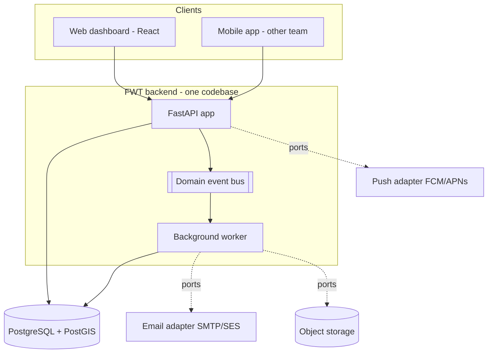

# 13 - Architecture

## 1. Shape
**Modular monolith**: one deployable FastAPI application plus a background worker (same codebase), PostgreSQL/PostGIS, object storage. Internal modules have strict boundaries so a module can be changed, replaced or extracted later (ADR-001). External providers sit behind ports/adapters (ports: push, email, storage, clock, map-tile config).



## 2. Stack
| Concern | Choice | Notes |
|---|---|---|
| Language/runtime | Python 3.12 | typed, `pyright` |
| Web framework | FastAPI (async) | OpenAPI is generated and is the contract |
| Validation | Pydantic v2 | all request/response schemas |
| ORM / migrations | SQLAlchemy 2.0 (async, asyncpg) + Alembic | reversible migrations |
| Spatial | PostGIS, GeoAlchemy2, Shapely | point-in-polygon in the database |
| Background jobs | Procrastinate (PostgreSQL-backed queue) | no Redis to run; swappable behind a `JobQueue` port |
| Auth | PyJWT, Argon2id (`argon2-cffi`) | see 14 |
| Excel | openpyxl (read), XlsxWriter (write) | import/export |
| Logging | structlog (JSON) | request ids, no secrets |
| Packaging | `uv`, `ruff`, `pyright`, `import-linter` | |
| Web | React, TypeScript, Vite, TanStack Router/Query/Table, Tailwind + shadcn/ui, react-hook-form + zod, Recharts | see 10 |
| Maps (web) | MapLibre GL JS 6.x, `react-map-gl` (MapLibre), Terra Draw (+ MapLibre adapter), Turf (modular); hosted streets + satellite tiles via config; place search through the provider's geocoding API (query text only) | ADR-006; Leaflet rejected; compatibility gate in M3 |
| API client | `openapi-typescript` | generated from the OpenAPI file |
| Container | Docker; docker-compose for local | |
| Pin versions | latest stable at project start, pinned in lock files | every dependency verified for recency and maintenance; see `17-dependencies.md` |

## 3. Repository layout
```
backend/
  pyproject.toml            deps, ruff, pyright, import-linter contracts
  alembic.ini  migrations/
  src/fw/
    main.py                 app factory, router registration
    core/                   config, db session, security, errors, clock, logging, events bus, audit hook
    modules/
      identity/  settings/  audit/  org/  jobs/  scheduling/  events/
      sync/  attendance/  payroll/  notifications/  imports/  reports/
        __init__.py         PUBLIC interface only
        api.py schemas.py service.py repository.py models.py ports.py
    rules/                  PURE logic (no db/http)
      scheduling/  attendance/  payroll/  country/ (ae.py, sa.py, base.py)
    adapters/               push/  email/  storage/  (implementations of ports)
  tools/                    export_openapi.py, simulator/, legacy_converter/
web/                        React app
docs/  .agents/  infra/
```

## 4. Module responsibilities and layering
| Module | Owns |
|---|---|
| core | config, DB session, security helpers, error types, clock, domain-event bus |
| identity | users, passwords, devices and binding, auth, permission + scope helpers |
| settings | effective-dated settings, time rules, public holidays, consent-policy versions |
| audit | audit log writing and querying |
| org | employees, reporting lines, groups, zones, accommodations, documents |
| jobs | worksites, boundaries, job items, occurrences |
| scheduling | scheduled work, leave, reassignment, gaps, recommendations |
| events | event ingestion, enrichment (PostGIS verdicts) |
| sync | change log, snapshot builder, delta/ack, device sync status |
| attendance | visits, gaps, daily calculation, versions, comments, approvals, alerts |
| payroll | salary revisions, runs, snapshots, job-cost allocation |
| notifications | notification log, document-expiry, push/email dispatch |
| imports | workbook registry, parser, validators, preview/commit |
| reports | report registry and exports |

**Layer contract** (a module may import only modules in lower layers, via their public `__init__`), enforced by `import-linter`:
```
1  reports | imports
2  payroll
3  attendance
4  sync | notifications
5  scheduling | events
6  jobs
7  org
8  settings | identity | audit
9  core
```
`rules/` and `adapters/` follow their own contracts: `rules` imports nothing from `modules` or `adapters`; modules use adapters only through ports.

**Domain events instead of upward calls.** Lower modules never call higher ones. When something changes they publish a domain event on the `core` bus (for example `ScheduledWorkChanged`, `EmployeeProfileChanged`, `WorksiteBoundaryChanged`, `EventsAccepted`). Handlers are registered at startup by higher modules: `sync` handlers write `sync_changes` rows **synchronously in the same transaction**; `attendance` handlers mark an employee/date dirty and enqueue a debounced recompute **after commit**. This keeps dependencies acyclic and makes behaviours easy to add or swap.

## 5. Ports and adapters
| Port (in `ports.py` / `core`) | Adapters |
|---|---|
| `PushProvider.send_silent(token, data)` | `FcmPushProvider`, `NullPushProvider` (dev/test) |
| `EmailProvider.send(to, template, context)` | `SmtpEmailProvider`, `SesEmailProvider`, `ConsoleEmailProvider` |
| `FileStorage.put/get/delete/url` | `LocalFileStorage`, `S3FileStorage` (any S3-compatible) |
| `Clock.now()` | `SystemClock`, `FrozenClock` |
| `JobQueue.enqueue(...)` | `ProcrastinateQueue` |
| Map tiles (dashboard) | configuration (`MAP_STYLE_STREETS_URL`, `MAP_STYLE_SATELLITE_URL`, `MAP_API_KEY`); no backend dependency |
| Geocoding (dashboard) | configuration (`GEOCODER_URL`, key); web-side wrapper in `features/map/`; no backend dependency |
Selected by configuration (`PUSH_BACKEND`, `EMAIL_BACKEND`, `FILE_STORAGE_BACKEND`). Changing provider = add an adapter + change config.

## 6. Country Rule Packs (one deployment per country, ADR-009)
`rules/country/base.py` defines a Protocol: `timezone`, `currency`, `weekend_days`, `ot2_weekdays`, `public_holidays(year)`, `gratuity_policy`, and **templates** for time rules. `ae.py` ships first; `sa.py` is added as data and a pack file. The pack for a calculation is chosen by the **record's country**: the site's country for scheduling and attendance, the employee's country for payroll and currency. Engines receive the pack as a parameter; no `if country ==` branches. Country-scoped settings, holidays, salary revisions and work-period rules are stored with their country (ADR-007). The code keeps every table country-keyed so the system can later be split into one deployment per country if a legal or hosting requirement appears.

## 7. Background jobs
| Job | Trigger | Purpose |
|---|---|---|
| `enrich_events` | after batch commit | PostGIS verdicts and flags |
| `recompute_attendance` | debounced 2 min after events; end of day; on schedule/setting change | rebuild visits/gaps/calculation |
| `extend_occurrence_horizon` | nightly | generate occurrences ahead (13 months) |
| `extend_sync_window` | nightly | emit UPSERTs for schedule items entering the 30-day window |
| `sync_compaction` | nightly | compact `sync_changes`, advance the cursor floor |
| `watchdog_no_activity`, `watchdog_stale_devices`, `watchdog_sync_lag` | every 5 min | alerts |
| `document_expiry_notifications` | daily | alerts and notifications |
| `detect_pending_visits` | every 15 min (acts after each site's day close) | create pending visits |
| `pending_visit_reminders` | hourly | remind while OPEN |
| `send_push`, `send_email` | on demand | via ports |
| `import_commit`, `report_export`, `payroll_preview` | on demand | long operations |

## 8. Configuration (env, via pydantic-settings)
`APP_ENV`, `DEPLOYMENT_COUNTRY` (AE or SA), `DATABASE_URL`, `JWT_SECRET` (or key paths), `ACCESS_TOKEN_MINUTES`, `REFRESH_TOKEN_DAYS`, `CORS_ORIGINS`, `PUSH_BACKEND`, `FCM_CREDENTIALS`, `EMAIL_BACKEND`, `SMTP_*`, `FILE_STORAGE_BACKEND`, `S3_*`, `MAP_STYLE_STREETS_URL`, `MAP_STYLE_SATELLITE_URL`, `MAP_API_KEY` (public, domain-restricted, used by the web build), `LOG_LEVEL`. Secrets come from the environment/secret manager, never the repository. Settings that business users change (alarm time, grace...) live in the database (`company_settings`), not env.

## 9. Deployment topology
- **One stack per country** (ADR-009): UAE stack first (Azure UAE North, in-country backup in UAE Central); a **separate Saudi stack in the Kingdom** when Saudi goes live, built from the same images. The two never share a database; cross-country management views show non-personal totals only.
- **Environments**: local (docker-compose: postgres/postgis, api, worker, web, mail catcher), staging, production.
- **Database roles**: `fw_migrator` (DDL), `fw_app` (DML; INSERT-only on `audit_logs`; no DELETE on `mobile_event_logs`), `fw_readonly` (for reporting/agent inspection).

## 10. Observability
JSON logs with request id and user id (no tokens, no coordinates trails); health endpoints `/health` and `/health/ready` (DB + queue); metrics: request latency, event ingest rate, queue depth, recompute duration, sync lag per device; alerts on queue backlog and failed jobs. Error tracking tool must be self-hostable or in-region if location/PII could appear in payloads (scrub fields).

## 11. Performance posture
Targets in `14-nonfunctional.md`. Hot paths: event batch ingest (single insert statement), week view (one query per level, indexed on `work_date`/`worksite_id`), sync changes (index on `(employee_id, id)`), attendance recompute (per employee/day, small).

## 12. Live positions and streaming
- On enrichment each event upserts `employee_last_position` **only if it is newer than the stored position** and issues `NOTIFY live_positions, '<employee_id>'` in the same transaction.
- An API instance holds one `LISTEN` connection and fans updates out to connected Server-Sent Events clients, filtered by each user's reporting scope. With several API instances each one listens independently, so no Redis is needed.
- `EventSource` cannot send an `Authorization` header, so the client first calls `POST /live/stream-ticket` (one-time, 30 s) and opens `/live/stream?ticket=`.
- The stream sends `position` and `state` messages and a heartbeat every 20 s. The client reconnects with backoff and falls back to polling `GET /live/positions` every 30 s.
- ACTIVE/OFFLINE is computed at read time (see 07), so stale workers turn OFFLINE even when no event arrives; the server also pushes a `state` message when a worker crosses `live_active_window_minutes`.
- A `LivePositionPublisher` port wraps `NOTIFY` so another transport (for example Redis pub/sub) can replace it without touching the event pipeline.

